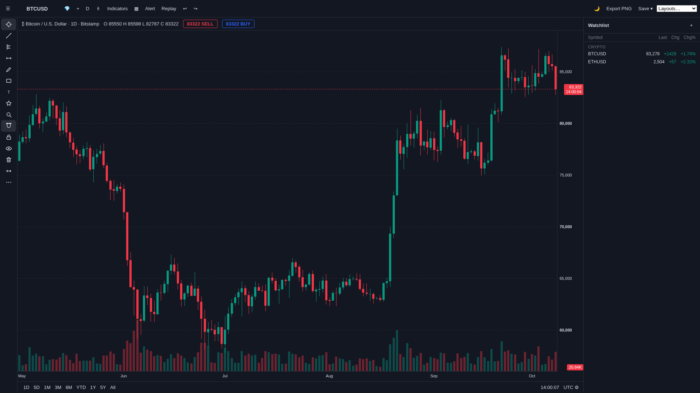
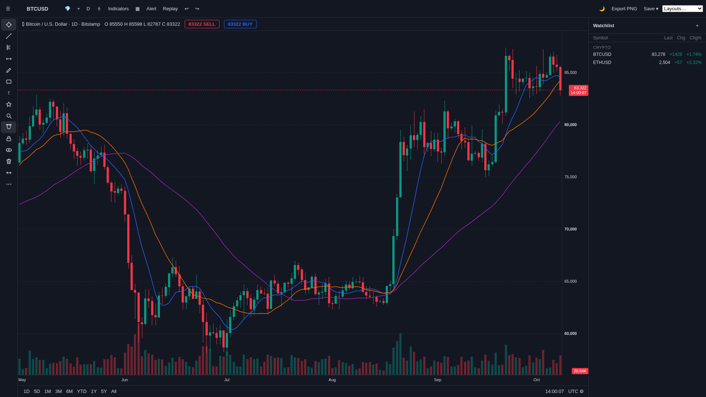
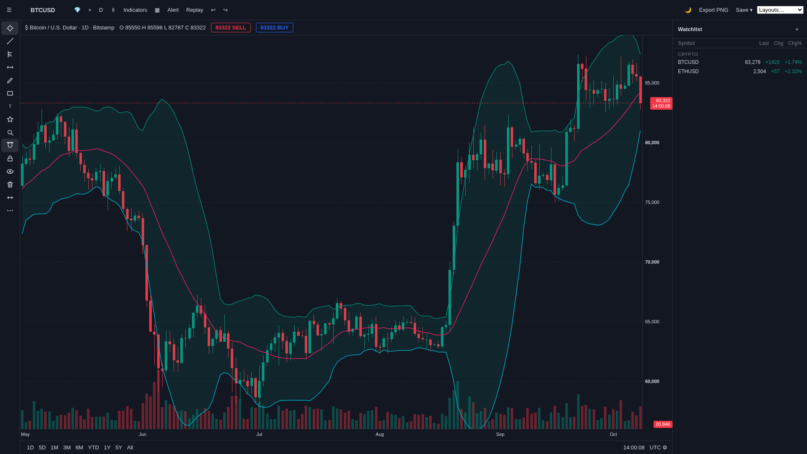
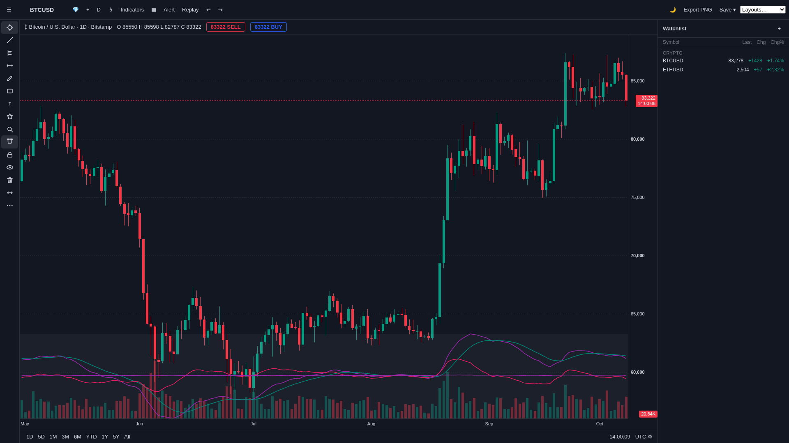
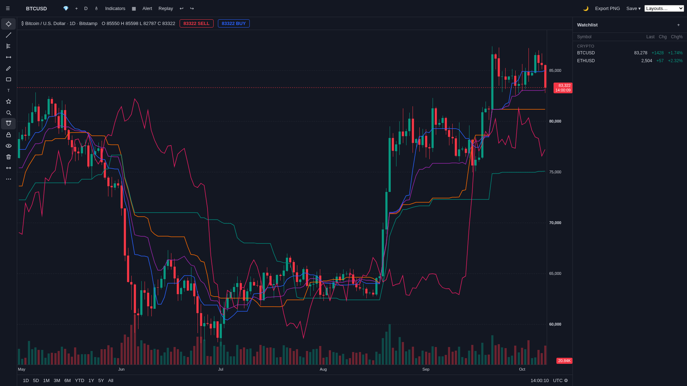
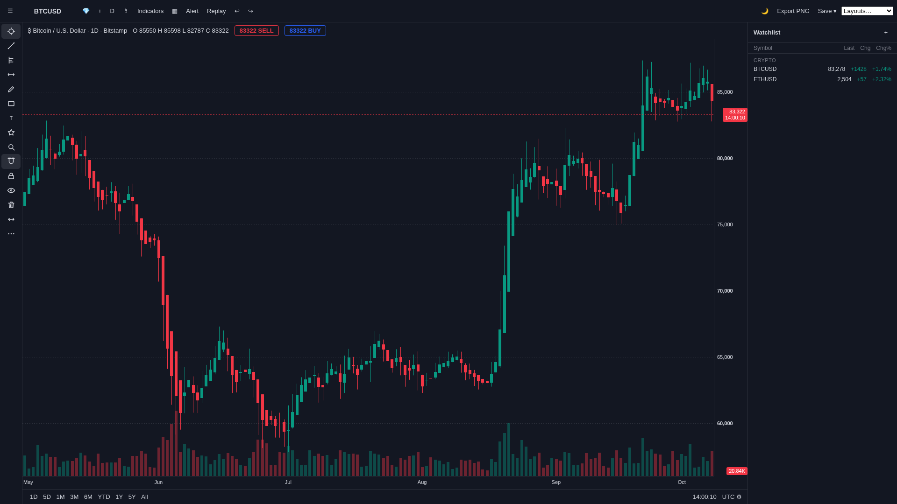
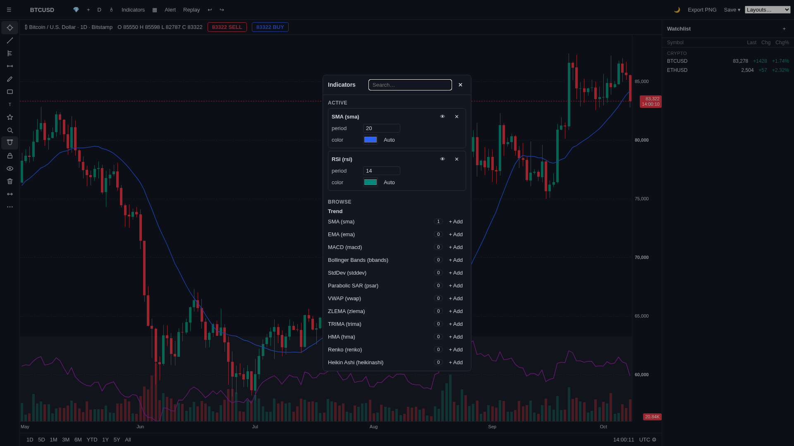
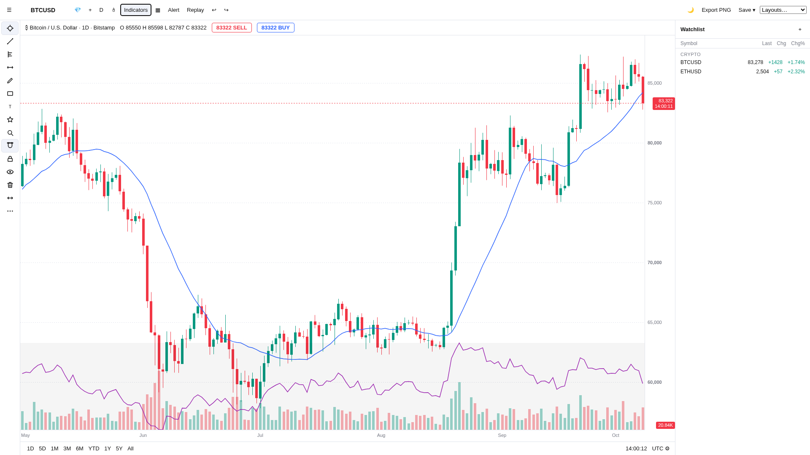

# Opentape — an open chart terminal

Opentape is a clean-room, dependency-free crypto chart terminal in vanilla
HTML/JS/CSS. No frameworks, no chart libraries, no backend, no build step:
one static page with a pure-canvas chart engine, live public market data,
drawings, 85 technical studies, replay mode, and a watchlist.



## Run it

```bash
python3 -m http.server 8787   # from the repo root
# open http://localhost:8787/
```

That's the whole thing — Python only. Live Binance candles load automatically;
offline it paints embedded data with a notice. `npm install` exists solely for
the optional Playwright verify/audit harness (`npm run verify`); the 46 unit
tests are stdlib-only (`npm test`, or bare `node --test tests/*.test.mjs`).

## What it does

- **Chart**: pan (drag, either axis follows TradingView conventions), wheel
  zoom per axis, auto price scale with manual override, crosshair + OHLC
  tooltip, last-price and volume tags that follow candle direction.
- **Drawings**: trendlines, Fibonacci, horizontals, text/icons — unlimited
  instances per tool, magnet snap to OHLC, undo/redo, lock, hide, alerts.
- **Studies**: 85 indicators with fully parameterized, multi-instance plots —
  build an SMA mesh, tune every period, color and toggle each instance.
- **Terminal extras**: replay mode, symbol/timeframe switching with real
  exchange intervals, multi-layout save, PNG export, watchlist, light/dark.

## Indicator showcase

All plots below are rendered by the app itself (BTCUSD daily, dark theme).

**SMA mesh** — three instances (10/20/50), distinct colors, one study:



**Bollinger Bands** — band fill between upper/lower:



**MACD + RSI** — shared oscillator pane, union-scaled:



**Ichimoku** — five-line overlay:



**Heikin-Ashi** — transform studies replace the candle source:



**Study modal** — every parameter editable, every study multi-instanceable:



**Light theme** — one click, no flash, persisted:



## Architecture (30 seconds)

- `index.html` — shell (topbar, rail, chart, axes, footer, watchlist).
- `js/viewstate.js` — single source of truth; every mutation flows through it.
- `js/chart.js` + `js/axes.js` + `js/overlay.js` — stacked canvases: market
  data, crosshair/drawings, axes.
- `js/data.js` — CCXT browser bundle (Binance default) with embedded
  first-paint fallback; GET-only public data, no keys, no trading desk.
- `js/studies.js` + `indicators/` — 85-study registry (overlay/bands/pane/
  multiline/transform) over vendored pure-math functions.
- `tooling/` — Playwright harness: verify, control audits, screenshot recipes.

## Status

Working terminal, actively refined against the live reference. See
`AGENTS.md` for the mission, conventions, and evidence notes. Stocks/forex
are out of scope until a CORS-open keyless (or bring-your-own-key) source
appears — crypto only, by design.
